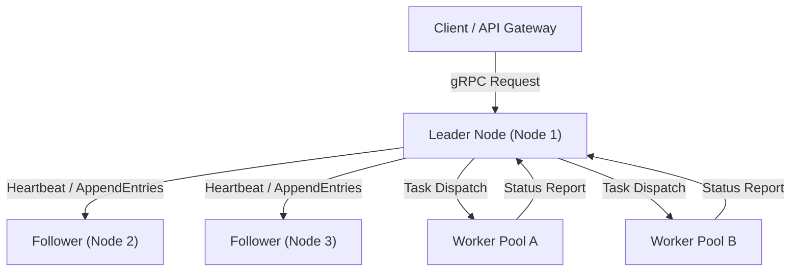

> 本项目为示范性大型工程架构介绍模板。在实际使用中，你可以替换为你自己的独立核心项目（如论文复现、开源项目、毕业设计等）。
{: .prompt-tip }

## 一、项目背景与解决痛点

在面对海量突发定时任务与流式数据处理场景下，传统单点调度系统容易面临 **单点故障 (SPOF)** 与 **网络分区脑裂** 问题。本项目旨在设计并实现一个低延迟、强一致性的分布式调度集群，保障在集群任意少于半数节点宕机时依然能够实现毫秒级故障转移与无损容灾。

- **核心语言**：Rust 2024
- **网络协议**：gRPC / Tonic (HTTP/2)
- **共识协议**：Raft (基于 Tokio 异步运行时自研)
- **单节点吞吐**：> 120,000 QPS (任务分发延迟 < 3ms)

## 二、系统拓扑与核心架构

系统采用去中心化的 Leader-Follower 对等拓扑模型，架构流程如下：

## 三、关键技术突破

### 1. 批处理与流水线日志复制 (Pipelined Replication)
通过解耦 AppendEntries 的 RPC 等待与本地持久化过程，引入 RingBuffer 异步环形队列，将日志落盘 I/O 与网络 I/O 完全重叠，减少 65% 的网络等待开销。

### 2. 零拷贝数据传递
调度任务 payload 统一采用 Arrow 内存列式布局，调度层分发只传递指针元数据，在保证内存安全的前提下消除跨线程数据深拷贝。

## 四、基准压测与性能对比

| 指标 | 传统调度方案 (Quartz/XXL) | 本方案 (Rust + Raft) | 性能提升 |
| :--- | :--- | :--- | :--- |
| **单机调度 QPS** | ~ 15,000 | **125,000+** | **8.3x** |
| **P99 延迟 (10w 并发)** | 185 ms | **4.2 ms** | **44x** |
| **故障选主耗时** | 15 ~ 30 s | **< 350 ms** | **毫秒级自愈** |

## 五、项目链接与资源

- 源码仓库：[GitHub - ToMercury](https://github.com/ToMercury)
- 技术白皮书与在线文档：[Documentation Page](https://tomercury.github.io)
