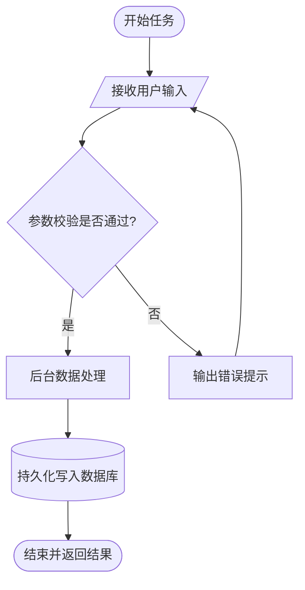
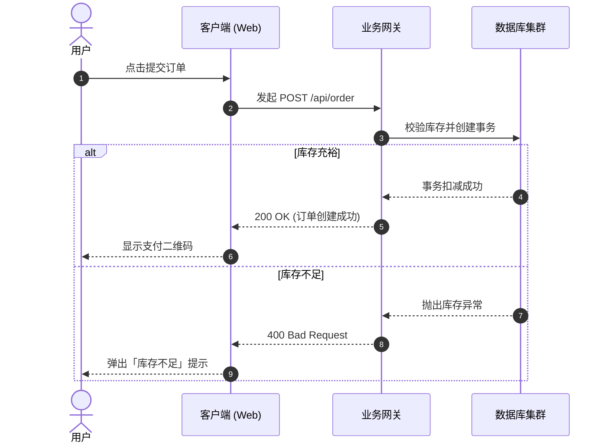
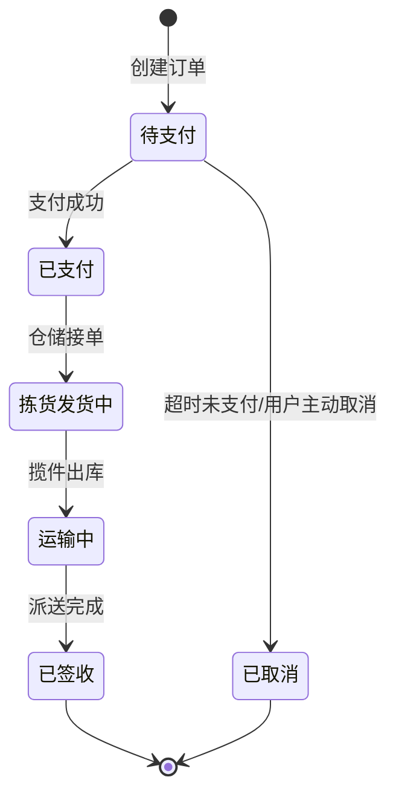

> **本文章用途与说明**：
> 本文日期设定在遥远的未来（2126 年），由于 Jekyll 默认策略会静默排除未来日期的文章，因此**不会在正式网站的文章列表和页面中公开展示**。
> 本文作为作者本地写作的**语法速查字典与排版参考模板**，需要使用时可随时打开本文件查阅 Markdown 及各类组件写法。
{: .prompt-info }

---

## 一、Front Matter 常用配置项速查

文章顶部的 YAML 头部控制着文章的各种元数据与功能开关：

```yaml
---
title: 文章主标题
description: 文章简要描述（显示在文章列表卡片、SEO Meta 标签中）
date: 2026-11-23 14:00:00 +0800 # 发布日期与时区
last_modified_at: 2026-11-24 10:00:00 +0800 # 可选，最后更新时间（亦可通过 Git 日志自动提取）
categories: [一级分类, 二级分类] # 分类层级
tags: [标签1, 标签2, 标签3] # 标签数组
math: true # 启用数学公式渲染 (MathJax)
mermaid: true # 启用图表渲染 (Mermaid)
pin: true # 是否置顶在列表页最上方
toc: true # 是否启用右侧目录导航（默认 true）
comments: true # 是否开启文章评论区（若全局配置了 Giscus/Disqus）
media_subpath: /assets/img/posts/ # 可选，图片资源公共相对路径前缀
image: # 可选，特色横幅封面图
  path: /assets/img/sample.jpg
  alt: 封面图说明
---
```

---

## 二、文本格式化与排版排布

日常写作中常用的基础内联样式：

| 效果 | Markdown / HTML 语法 | 渲染效果 |
| :--- | :--- | :--- |
| **加粗** | `**加粗文本**` 或 `__加粗文本__` | **加粗文本** |
| *斜体* | `*斜体文本*` 或 `_斜体文本_` | *斜体文本* |
| ***粗斜体*** | `***粗斜体***` | ***粗斜体*** |
| ~~删除线~~ | `~~删除线文本~~` | ~~删除线文本~~ |
| <u>下划线</u> | `<u>下划线文本</u>` | <u>下划线文本</u> |
| <mark>高亮标记</mark> | `<mark>高亮文本</mark>` | <mark>高亮文本</mark> |
| 上标与下标 | `X<sup>2</sup>` 与 `H<sub>2</sub>O` | X<sup>2</sup> 与 H<sub>2</sub>O |
| 行内代码 | `` `inline code` `` | `inline code` |
| 键盘快捷键 | `<kbd>Ctrl</kbd> + <kbd>C</kbd>` | <kbd>Ctrl</kbd> + <kbd>C</kbd> |
| 缩写悬浮提示 | `<abbr title="HyperText Markup Language">HTML</abbr>` | <abbr title="HyperText Markup Language">HTML</abbr> |

---

## 三、Chirpy 专属提示框 (Prompts)

Chirpy 提供了 4 种高对比度、带色彩和图标的提示块，语法为在引用块后紧跟 `{: .prompt-<type> }`：

### 1. 技巧提示 (Tip)

> 这是一个 **Tip（提示/小技巧）** 提示框。常用于提供实用技巧、最佳实践或推荐做法。
{: .prompt-tip }

### 2. 信息通知 (Info)

> 这是一个 **Info（常规信息/说明）** 提示框。常用于提供背景知识、补充说明或上下文环境。
{: .prompt-info }

### 3. 注意警告 (Warning)

> 这是一个 **Warning（注意/警告）** 提示框。常用于提醒读者注意潜在风险、版本兼容性或关键限制。
{: .prompt-warning }

### 4. 危险报警 (Danger)

> 这是一个 **Danger（危险/错误）** 提示框。常用于警告高危操作、可能导致数据丢失或不可逆的命令。
{: .prompt-danger }

---

## 四、代码块高级特性

### 1. 带文件名标注的代码块

通过在代码块末尾追加 `{: file="文件名" }`，可在代码框顶部呈现带图标的文件名标签与一键复制按钮：

```python
# 这是一个 Python 脚本示例
import os
import sys

def get_system_info():
    return {
        "platform": sys.platform,
        "cwd": os.getcwd()
    }

if __name__ == "__main__":
    print(get_system_info())
```
{: file="scripts/system_info.py" }

### 2. 禁用行号 (No Line Numbers)

默认情况下多行代码块会自动生成行号，若想针对单次输出隐藏行号，可在代码块后追加 `{: .nolineno }`：

```bash
git clone https://github.com/ToMercury/tomercury.github.io.git
cd tomercury.github.io
bundle install && npm install
bash tools/run.sh
```
{: .nolineno }

### 3. 多种常用语言高亮

```yaml
# YAML 配置文件示例
site:
  title: ToMercury Blog
  url: https://tomercury.github.io
  social:
    github: ToMercury
```
{: file="_config.yml" }

```rust
// Rust 核心代码示例
#[derive(Debug, Clone)]
pub struct WorkerNode {
    pub id: u64,
    pub address: String,
    pub is_active: bool,
}

impl WorkerNode {
    pub fn new(id: u64, addr: &str) -> Self {
        Self { id, address: addr.to_string(), is_active: true }
    }
}
```
{: file="src/node.rs" }

---

## 五、数学公式 (MathJax / KaTeX)

当 Front Matter 中包含 `math: true` 时，网站会自动加载公式渲染引擎。

### 1. 行内公式

行内公式使用单个美元符号包裹，例如质能方程为 $E = mc^2$，欧拉公式为 $e^{i\pi} + 1 = 0$。

### 2. 独立块级公式

块级公式使用双美元符号包裹：

正态分布概率密度函数：

$$
f(x) = \frac{1}{\sigma \sqrt{2\pi}} \exp\left( -\frac{(x - \mu)^2}{2\sigma^2} \right)
$$

高斯积分公式：

$$
\int_{-\infty}^{+\infty} e^{-x^2} \, dx = \sqrt{\pi}
$$

分段函数与矩阵表达：

$$
f(n) =
\begin{cases}
\frac{n}{2}, & \text{若 } n \text{ 为偶数} \\
3n + 1, & \text{若 } n \text{ 为奇数}
\end{cases}
$$

$$
\mathbf{A} =
\begin{pmatrix}
a_{11} & a_{12} & \cdots & a_{1n} \\
a_{21} & a_{22} & \cdots & a_{2n} \\
\vdots & \vdots & \ddots & \vdots \\
a_{m1} & a_{m2} & \cdots & a_{mn}
\end{pmatrix}
$$

---

## 六、Mermaid 图表排版

在 Front Matter 中配置 `mermaid: true`，可以直接在代码块中使用 ````mermaid` 绘制各种图表：

### 1. 架构流程图 (Flowchart)



### 2. 时序调用图 (Sequence Diagram)



### 3. 状态转换机 (State Diagram)



### 4. Git 版本流向图 (Git Graph)

```mermaid
gitGraph
    commit id: "v1.0.0"
    commit id: "Init Setup"
    branch develop
    checkout develop
    commit id: "Feature: UI"
    commit id: "Feature: API"
    checkout master
    merge develop id: "Release v1.1.0"
    commit id: "Hotfix"
```

---

## 七、表格与排版对齐

Markdown 表格支持冒号 `:---` 左对齐、`:---:` 居中对齐、`---:` 右对齐。在移动端屏幕下，Chirpy 会自动将宽表格包裹在可横向滚动的容器内：

| 项目名称 | 分类 / 领域 | 状态 | 综合评分 | 备注说明 |
| :--- | :---: | :---: | ---: | :--- |
| **Sniptool** | Linux 开源工具 | <span class="badge bg-success">活跃维护</span> | 9.8 / 10 | 专为 Linux 深度定制的截屏利器 |
| **投资理财专著** | 财商书籍通识 | <span class="badge bg-primary">已定稿</span> | 9.6 / 10 | 98 页 LaTeX 编译全书 |
| **手工生活编织** | 个人生活手作 | <span class="badge bg-info text-dark">持续更新</span> | 9.5 / 10 | 温暖连指手套与趣味钩针玩偶 |
| **个人知识库** | 思考与博客 | <span class="badge bg-secondary">长期迭代</span> | 9.7 / 10 | 深入记录技术与认知体系 |

---

## 八、列表与任务交互清单

### 1. 嵌套多级列表

1. 第一部分：系统规划
   - 收集与整理需求分析
   - 确定总体技术架构选型
     - 语言：Python 3.10+
     - 图形界面：PySide6 (Qt)
2. 第二部分：实现与打磨
   - 核心功能原型验证
   - 边缘交互体验优化

### 2. 交互式任务清单 (Task Lists)

- [x] 完成基础框架初始化
- [x] 适配 Debian 13 与 Xfce 桌面多屏 DPI 自动补偿
- [x] 集成离线 Tesseract OCR 文字识别引擎
- [ ] 接入多模型 AI 辅助翻译插件
- [ ] 编写全套离线自动化回归测试用例

### 3. 定义列表 (Definition Lists)

词条：资产负债表
: 反映企业在特定日期（时点）拥有的资产、承担的债务及所有者享有的剩余权益的财务报表。

词条：复利效应
: 将每一期的收益加入本金继续产生收益的过程，时间越长，指数级爆发威力越大。

---

## 九、引用与嵌套引用

> 普通单层引用：
> 简单的事情重复做，你就是专家；重复的事情用心做，你就是赢家。

> 嵌套多级引用：
> 第一层引用：巴菲特曾经说过：
>
> > 第二层引用：投资的第一条法则是不要亏损，第二条法则是永远记住第一条。
>
> 始终将风险控制置于首位。

---

## 十、图片样式与排版控制

Chirpy 为图片提供了多种内置辅助样式类，通过在图片 markdown 语法后紧跟 `{:` 实现：

### 1. 宽度与居中缩放

```markdown
{: .w-50 .normal }
```

{: .w-25 .normal }
_图片说明文本：通过 `.w-25` 控制宽度缩放，加下划线为图片居中注释_

### 2. 浮动排版与阴影效果

- `{: .w-75 }` / `{: .w-50 }` / `{: .w-25 }`：控制相对宽度百分比
- `{: .left }`：图片向左浮动，文字环绕
- `{: .right }`：图片向右浮动，文字环绕
- `{: .shadow }`：为图片添加阴影边缘
- `{: .rounded-10 }`：为图片边缘添加 10px 圆角
- `{: .preview-img }`：作为封面缩略图样式

---

## 十一、媒体与第三方平台嵌入 (Embeds)

Chirpy 内置了多种主流媒体平台的嵌入模板，在文章中可直接通过 Liquid 标签快速引入：

### 1. B站视频 (Bilibili)

```liquid

```

### 2. YouTube 视频

```liquid

```

### 3. 本地与外部音视频

```liquid


```

---

## 十二、HTML5 原生与 Bootstrap 常用组件

### 1. 折叠下拉面板 (Details / Summary)

<details>
  <summary><i class="fas fa-chevron-right me-1"></i> <strong>点击展开查看深度技术分析与详细参数</strong></summary>
  <div class="mt-2 p-3 bg-light rounded border text-muted">
    这里是折叠在内部的详细说明文本或长篇代码日志。使用 <code>&lt;details&gt;</code> 标签可以让文章页面保持清爽，仅在读者感兴趣时展开浏览。
  </div>
</details>

<br>

### 2. Bootstrap 彩色徽章 (Badges)

<span class="badge bg-primary">Primary</span>
<span class="badge bg-secondary">Secondary</span>
<span class="badge bg-success">Success</span>
<span class="badge bg-danger">Danger</span>
<span class="badge bg-warning text-dark">Warning</span>
<span class="badge bg-info text-dark">Info</span>
<span class="badge bg-light text-dark">Light</span>
<span class="badge bg-dark">Dark</span>

### 3. Bootstrap 进度条 (Progress Bar)

<div class="progress mb-2" style="height: 20px;">
  <div class="progress-bar progress-bar-striped progress-bar-animated bg-success" role="progressbar" style="width: 85%;" aria-valuenow="85" aria-valuemin="0" aria-valuemax="100">项目完成度 85%</div>
</div>

---

## 十三、脚注与站内/站外链接

这是关于个人知识管理的一段论述[^1]，读者在阅读时可以点击上标数字直接平滑跳转至页脚对应的解释区域。
你也可以跳转访问站内的[关于我](/)主页，或者前往[GitHub 组织主页](https://github.com/ToMercury){: target="_blank" rel="noopener noreferrer" }查看所有开源代码库。

---

[^1]: 这里是脚注的详细注释正文。Chirpy 支持通过右侧的回跳箭头返回正文对应锚点位置。
